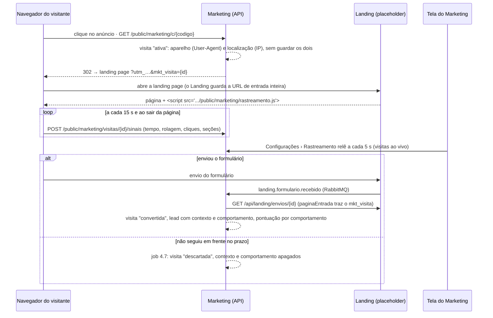

# IoT do Marketing: o lead 0 de ponta a ponta

Roteiro para apresentar o ponto de IoT do módulo e para quem for continuar o trabalho. O desenho completo está no [documento norteador](documento-norteador.md) (seção 2, "Lead 0", e seções 3, 4.7, 5, 6, 9.2 e 9.4).

## A ideia em uma frase

Quem clica num anúncio e cai na landing page ainda não é lead: é o **lead 0**. O Marketing registra o **aparelho** dessa pessoa (tipo de dispositivo, sistema, navegador, localização aproximada, idioma, fuso e tela) e o **comportamento** dela na página (tempo, rolagem, botões clicados, seções vistas). Se ela enviar o formulário, esses dados vão para o lead e **somam pontos na qualificação**. Se não seguir em frente no prazo, **os dados são descartados**.

## Como os dados andam



## O que é real e o que é simulado

| Peça | Situação | Para a versão final |
|---|---|---|
| Link de campanha, visita, sinais, vínculo com o lead, pontuação, descarte | **Real**, no `marketing-api` (`rastreamento/`, `V11`), com testes de unidade e de ponta a ponta contra Postgres e RabbitMQ (`VisitaDeAnuncioIntegracaoTest`, `RastreamentoApiTest`) | nada a trocar |
| Telas (Leads e Configurações › Rastreamento) | **Real**, no `marketing-web`, ligadas à API | ganhar o SSE do painel (R6) no lugar da releitura a cada 5 s |
| Script de rastreamento (`rastreamento.js`) | **Real**, servido pela API | nada a trocar |
| Landing page que carrega o script | **Placeholder** (`landing-web`), simula a tag que pedimos ao Grupo 7 | o Landing real põe a tag (pedido 6 do [landing-requisitos.md](contratos/landing-requisitos.md)); o Marketing não muda |
| Localização por IP | **Simulada** (`LocalizacaoSimulada`, sempre Goiânia, marcada "simulada" na tela) | outra implementação de `LocalizacaoPorIp` com GeoLite2, marcada `@Primary` (R4) |
| Anúncio | **Simulado** pelo botão "Simular clique" | colar a URL pública do link no Meta ou no Google Ads |
| Regras de comportamento | por **SQL** ([infra/demo/regras-comportamento.sql](../infra/demo/regras-comportamento.sql)) | tela de qualificação (W4) e valores iniciais (D7), tarefa R5 |

## Como subir localmente

O ponta a ponta precisa do **identity da plataforma**, que nunca é simulado: a tela usa o token de um usuário de teste, e a leitura do envio no Landing usa o token de serviço do Marketing. Sem ele, o lead fica "aguardando o Landing" e a visita não se liga. Por isso o banco, o broker e o identity vêm do compose do `infra-integrador-2026`, e os quatro apps deste repositório rodam no host, apontando para eles. Isso também evita o banco local antigo (o volume com a `V3` da branch `feat/iot-ingestao-leads`): o banco da plataforma é outro.

### Com o script (recomendado)

Pré-requisitos: Docker Desktop ligado, Node, JDK 21 e o `infra-integrador-2026` clonado (com `git pull`). Na raiz deste repositório, no PowerShell:

```powershell
.\scripts\dev-plataforma.ps1 -Infra 'C:\caminho\para\infra-integrador-2026'
```

O [script](../scripts/dev-plataforma.ps1):

1. cria o `.env` do infra com o `scripts/gerar-env.sh` dele (pelo Git Bash), se ainda não existir;
2. para a infraestrutura do compose deste repositório, se estiver de pé (as portas 5432, 5672 e 15672 conflitam). Não apaga nada;
3. sobe `postgres`, `rabbitmq`, `rabbitmq-init`, `mailpit`, `identity` e `gateway` da plataforma;
4. faz login como `marketing@empresa-a.dev` (senha `Plataforma2026`) e grava o token em `marketing-web/.env.local`;
5. abre API (8087), front (3007), placeholder do Landing (3008/8088) e stub do CRM (8082), cada um numa janela, com as senhas do `.env` do infra;
6. espera a API (as migrations criam as tabelas) e aplica [infra/demo/regras-comportamento.sql](../infra/demo/regras-comportamento.sql): quatro regras de comportamento e o prazo de 2 minutos para a Empresa A.

| Quando | Comando |
|---|---|
| O token venceu (dura 15 minutos; a tela começa a dar erro de sessão) | `.\scripts\dev-plataforma.ps1 -SoToken` e recarregue a página |
| Sem janelas, com o log em `%TEMP%\marketing-dev\*.log` | `-Ocultos` |
| Os containers da plataforma já estão de pé | `-SemInfra` |
| Encerrar os apps (os containers continuam) | `.\scripts\dev-plataforma.ps1 -Parar` |
| Não repetir o `-Infra` | defina a variável `INFRA_INTEGRADOR` com a pasta do infra |

Para zerar os dados da demo, no infra: `docker compose down -v` (**apaga o banco da plataforma local**) e rode o script de novo.

### Sem o script

Os mesmos passos, à mão:

1. No infra, pelo Git Bash: `bash scripts/gerar-env.sh` e `docker compose --profile plataforma up -d postgres rabbitmq rabbitmq-init mailpit identity gateway`.
2. Rode os apps com as senhas do `.env` do infra, cada um no seu terminal (o placeholder e o stub usam a mesma variável `RABBITMQ_URL`, com usuários diferentes):
   - API: `DB_APP_PASSWORD` = `DB_APP_MARKETING_SENHA`, `DB_OWNER_PASSWORD` = `DB_OWN_MARKETING_SENHA`, `RABBITMQ_PASSWORD` = `MQ_MARKETING_SENHA`, `SVC_CLIENT_SECRET` = `SVC_MARKETING_SEGREDO`, e `npm run dev:api`;
   - Landing: `RABBITMQ_URL=amqp://mq_landing:<MQ_LANDING_SENHA>@localhost:5672/plataforma` e `npm run dev:landing`;
   - CRM: `RABBITMQ_URL=amqp://mq_crm:<MQ_CRM_SENHA>@localhost:5672/plataforma` e `npm run dev:crm`;
   - front: `POST http://localhost:8081/api/identity/auth/login` com `{"email":"marketing@empresa-a.dev","senha":"Plataforma2026"}`, `VITE_TOKEN_DEV=<data.accessToken>` em `marketing-web/.env.local` e `npm run dev:web`.
3. Depois que a API subir, no infra: `docker compose cp <este repo>/infra/demo/regras-comportamento.sql postgres:/tmp/r.sql` e `docker compose exec -T postgres psql -U postgres -d plataforma -f /tmp/r.sql`. No PowerShell, não passe o SQL por pipe: o PowerShell 5.1 troca os acentos por `?`.

### Último passo

Abra `http://localhost:3007/modulos/marketing/configuracoes` e crie um link de campanha: nome "Black Friday · Google", URL `http://localhost:3008/`, `utm_source=google`, `utm_medium=cpc`, `utm_campaign=black-friday-2026`.

### Conferido em 09/11/2026

Com o script e os apps de pé, o fluxo foi exercitado pelo HTTP, como o navegador faria (não por cliques num navegador):

| Passo | Resultado |
|---|---|
| link criado pela API, pelo proxy do front | URL pública `http://localhost:8087/public/marketing/c/<codigo>` |
| clique com *User-Agent* de iPhone | `302` para `http://localhost:3008/?utm_source=google&utm_medium=cpc&utm_campaign=black-friday-2026&mkt_visita=<id>` |
| landing e `rastreamento.js` | `200` e `200` |
| sinais em `text/plain` com `Origin: http://localhost:3008` | `200`; a visita aparece ativa, smartphone, iOS, Goiânia (simulada), 74 s |
| envio do formulário no placeholder | lead na etapa 3, respostas lidas, MQL morno com 50 pontos (20 + 15 + 10 + 5 das regras de comportamento) |
| timeline do lead | `etapa_alterada > handoff_crm > respostas_lidas > consentimento_registrado > visita_vinculada > qualificacao_alterada` |
| visita sem envio | descartada 8 s depois de vencer o prazo, sem contexto nem comportamento; resumo de 24 h com 2 cliques, 1 convertida, 1 descartada, 50% |

### Se algo der errado

- **`'mvnw.cmd' não é reconhecido`** ao rodar `npm run dev:api`: corrigido em `scripts/api.mjs`, que agora chama o wrapper pelo caminho completo.
- **O lead não aparece depois do envio** e o log do Landing mostra `Restarting 'server/index.ts'`: era o `node --watch` reiniciando o placeholder por causa de um arquivo do `node_modules`, perdendo o envio em memória antes do evento. Corrigido com `--watch-path` no `landing-web` e no `crm-stub`.
- **A tela dá erro de sessão:** o token venceu; rode `-SoToken`.
- **`docker compose up` falha com *TLS handshake timeout*:** a rede caiu no meio do download da imagem do identity; rode de novo.

## Roteiro (uns 5 minutos)

1. **O problema.** "Quem clica no anúncio e não preenche o formulário some. A gente não sabe de que aparelho veio nem o que fez na página." Mostre Configurações › Rastreamento: resumo das 24 h, o link e a tag do script.
2. **O clique.** Em "Simular clique", abra o link numa aba com o DevTools em modo celular (Ctrl+Shift+M, iPhone), para o aparelho aparecer como smartphone. Volte à tela: a visita aparece como **lead 0**, com a contagem regressiva do descarte.
3. **O comportamento.** Na landing page, role até "Planos e preços", clique em "Simular o investimento" e em "Ver planos", e espere uns 30 s. Na tela, o tempo, a rolagem e os cliques sobem sozinhos. Abra a visita: contexto técnico e comportamento.
4. **A conversão.** Clique em "Fale conosco", preencha o formulário (com o consentimento) e envie. A visita vira **convertida**. "Abrir o lead": aba **Interação** com o mesmo rastro, e aba **Pontuação** com as regras de comportamento somando pontos (em roxo), o que pode levar o lead a MQL e ao rodízio.
5. **O descarte.** Faça outro clique, numa janela anônima, e não envie nada. Em 2 minutos sem sinal, a visita vira **descartada**: o contexto e o comportamento somem e fica só a contagem. É a regra do lead 0 e a minimização de dados da LGPD.

## Cuidados que valem para a banca

- **Sem dado pessoal na visita:** nem IP, nem *User-Agent* bruto, nem o que se digita. O script não lê campos de formulário e não usa cookie; os sinais tiram a consulta das URLs.
- **Multi-tenant:** a rota pública acha o tenant pelo código do link ou pelo id da visita, gerados pelo servidor.
- **Base legal:** a proposta é legítimo interesse, com descarte no prazo; está como pendência com o Grupo 7 e os professores (norteador, seção 11).
