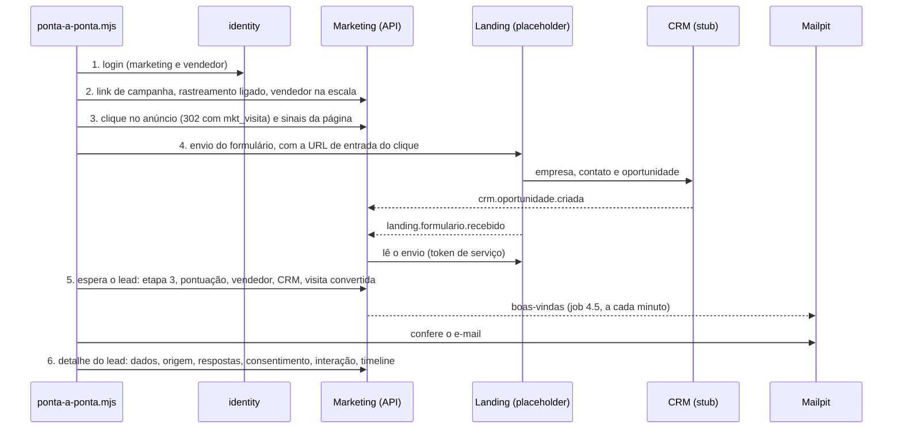

# Roteiro ponta a ponta (I4)

Como conferir, numa máquina só, a jornada inteira do lead: anúncio, landing page, formulário, CRM, etapa 3, pontuação, vendedor, e-mail de boas-vindas e a tela do Marketing. Vale para a banca, para quem for continuar o trabalho e como pré-condição da sessão do checklist com o Grupo 2.

Primeira vez no projeto? Comece pelo [como-rodar.md](como-rodar.md), que cobre os pré-requisitos, a subida e os problemas comuns. Este arquivo é o roteiro da conferência.

O roteiro tem duas partes: o **script** `scripts/ponta-a-ponta.mjs`, que percorre e confere tudo pelo HTTP em uns 2 minutos, e a **conferência à mão** da tela, que o script não faz.

## O que o script confere



| Passo | O que o script faz | O que confere |
|---|---|---|
| 1. Login | `POST /api/identity/auth/login` como `marketing@empresa-a.dev` e `vendedor@empresa-a.dev` | API no ar; token do tenant Empresa A com as permissões do roteiro; `401` com envelope sem token |
| 2. Preparação | `POST /api/marketing/links-campanha`; `PUT /api/marketing/rodizio/vendedores`; lê `/api/marketing/qualificacao` | link com `utm_source=google`, `utm_medium=cpc` e uma campanha nova por execução; vendedor ativo na escala; rodízio dentro do horário de atendimento |
| 3. Clique e sinais | `GET /public/marketing/c/{codigo}` com *User-Agent* de iPhone, `rastreamento.js`, `POST /public/marketing/visitas/{id}/sinais` | `302` com `mkt_visita` e as UTM; `404` com envelope para código inexistente; visita ativa, smartphone, com tempo, rolagem e cliques gravados |
| 4. Formulário | `POST /public/landing/formularios/fk_empresaA01/envios` com consentimento e a URL de entrada do clique | envio aceito; recusado (`400`) sem consentimento |
| 5. Lead | espera o lead em `GET /api/marketing/leads?q=<e-mail>` | etapa 3; campanha e aparelho na lista; oportunidade do CRM ligada; pontuação com a regra de comportamento; MQL; vendedor da escala; visita convertida e ligada ao lead; e-mail de boas-vindas no Mailpit |
| 6. Detalhe | `GET /api/marketing/leads/{id}` | contato, origem (UTM e `mkt_visita`), respostas lidas, consentimento com o texto do termo, interação (aparelho e comportamento), ids do CRM, timeline em ordem, boas-vindas em `lead_comunicacoes`; `404` para lead inexistente; o painel (funil e lead 0) |
| 7. Descarte (`--descarte`) | segundo clique, sem envio | visita descartada no prazo do tenant, sem contexto técnico nem comportamento |

Cada execução usa um e-mail e uma campanha novos (`ponta-a-ponta+<id>@exemplo.dev`), então dá para rodar quantas vezes quiser sem limpar nada.

## Como subir

Pré-requisitos: Docker Desktop ligado (`docker info`), Node 24 (o script `ponta-a-ponta.mjs` roda a partir do 18), JDK 21 ou mais novo e o `infra-integrador-2026` clonado, com `git pull` feito. Na raiz deste repositório, no PowerShell:

```powershell
.\scripts\dev-plataforma.ps1 -Infra 'C:\caminho\para\infra-integrador-2026' -Ocultos
```

O script sobe Postgres, RabbitMQ, Mailpit, identity e gateway da plataforma, abre a API (8087), o front (3007), o placeholder do Landing (3008 e 8088) e o stub do CRM (8082), e aplica o prazo de descarte de 2 minutos (`infra/demo/prazo-descarte.sql`). Detalhes e pegadinhas em [demo-iot.md](demo-iot.md). Com `-Ocultos`, os logs ficam em `%TEMP%\marketing-dev\*.log`.

Espere a linha `Pronto.` do script. A primeira subida baixa imagens e compila a API e pode levar alguns minutos.

## Como rodar o script

```powershell
node scripts/ponta-a-ponta.mjs
```

| Opção | Para quê |
|---|---|
| `--descarte` | acrescenta o passo 7 (espera o descarte de uma visita sem envio; mais uns 2 a 3 minutos) |
| `--manter-horario` | não abre a escala 24 h quando o rodízio está fora do horário comercial; o vendedor pode ficar para depois |
| `--espera=<s>` | limite de espera de cada passo assíncrono (padrão 150 s) |

Endereços diferentes dos padrões do `dev-plataforma.ps1`: variáveis `MARKETING_URL`, `IDENTITY_URL`, `LANDING_URL` e `MAILPIT_URL`. Para outro usuário, `USUARIO_EMAIL`, `USUARIO_SENHA` e `VENDEDOR_EMAIL`.

Saída esperada: uma linha verde (`✓`) por conferência e, no fim, `✓ PONTA A PONTA OK: 64 conferencias passaram, 0 falharam` (com `--descarte`; sem ele são 60). Qualquer `✗` vermelho traz o motivo; o código de saída é `0` só se tudo passou. Se o script parar no passo 1, a plataforma não subiu; no passo 5, olhe os logs de `dev-api.log`, `dev-landing.log` e `dev-crm.log`.

Efeitos no tenant de teste: um link de campanha por execução, o vendedor de teste na escala do rodízio e, se estiver fora do horário comercial (padrão: segunda a sexta, das 8h às 18h, horário de Brasília), a escala aberta 24 horas. Para voltar, use Configurações › Qualificação e distribuição.

## O que o script não confere: a tela

Com a execução do script no ar (o lead dele fica na lista), abra `http://localhost:3007/modulos/marketing/leads` e confira à mão:

1. **Lista de Leads:** o lead `Teste Ponta a Ponta <id>` aparece na etapa 3, com a faixa (MQL), a pontuação, a campanha `ponta-a-ponta-<id>`, o aparelho (smartphone) e a marca "no CRM". Os filtros por campanha, vendedor e período o encontram.
2. **Detalhe do lead** (clique na linha). O modal tem seis abas:
   - **Dados:** quatro seções seguidas. *Contato* (nome, e-mail, telefone); *Funil e distribuição* (etapa, data de entrada, **vendedor** com o botão de atribuir ou reatribuir); *Consentimento* (o aceite e o histórico com o texto do termo; IP e *User-Agent* só aparecem aqui); *Comunicações e ciclo de vida* (boas-vindas e aquecimento); e *CRM* (oportunidade, empresa e contato; no modo sozinho, o front busca os resumos em `/api/crm` pelo proxy do Vite, e uma falha vira "indisponível no CRM");
   - **Origem:** canal, página de entrada com o `mkt_visita`, primeiro e último toque e as UTM (`google` / `cpc`, a campanha);
   - **Interação:** aparelho, sistema e navegador, localização (marcada "simulada"), idioma, fuso e tela, tempo na página, rolagem, botões clicados e páginas e seções vistas;
   - **Respostas:** os nove campos do formulário, lidos do Landing;
   - **Pontuação:** a faixa e as regras que somaram pontos, com as de comportamento (tempo na página, seção de preços, clique no simulador, rolagem);
   - **Timeline:** `etapa_alterada`, `handoff_crm`, `respostas_lidas`, `consentimento_registrado`, `visita_vinculada`, `qualificacao_alterada` e, para MQL, `vendedor_atribuido`; a comunicação de boas-vindas entra quando o e-mail sai.
3. **Configurações › Rastreamento:** o link `Ponta a ponta <id>` com 1 clique; a visita aparece como convertida e, no resumo das 24 h, a taxa de conversão sobe.
4. **Painel:** o funil conta o lead na etapa 3, o lead aparece em "Leads recentes" e o cartão do lead 0 mostra a visita convertida. O selo "Ao vivo" indica que o fluxo em tempo real está conectado.
5. **E-mail:** `http://localhost:8025` (Mailpit) tem a mensagem de boas-vindas para o e-mail do lead.

O token do front dura 15 minutos: `.\scripts\dev-plataforma.ps1 -SoToken` e recarregue a página. Para ver o módulo dentro da casca, suba com `-ComCasca` e abra `http://localhost:8080/`.

## Se algo falhar

| Sintoma | Causa provável |
|---|---|
| Passo 1: `A API do Marketing nao respondeu` | a API ainda está subindo (espere o `Pronto.` do `dev-plataforma.ps1`) ou caiu; veja `%TEMP%\marketing-dev\dev-api.log` |
| Passo 1: login falha | identity fora do ar ou usuário de teste inexistente; veja `docs/usuarios-de-teste.md` do infra |
| Passo 4: formulário não responde | o placeholder do Landing não subiu, ou subiu em outra porta (`LANDING_URL`) |
| Passo 5: o lead não aparece | o evento `landing.formulario.recebido` não chegou (RabbitMQ, usuário `mq_landing`) ou o Marketing não leu o envio (token de serviço); veja `dev-landing.log` e `dev-api.log`. O Landing e o CRM guardam tudo **em memória**: reiniciar um deles apaga os envios |
| Passo 5: lead sem vendedor | fora do horário de atendimento com `--manter-horario`, ou escala vazia |
| Passo 5: sem e-mail de boas-vindas | o job 4.5 roda uma vez por minuto (espere); SMTP fora do ar; o Mailpit da plataforma precisa estar na porta 1025 |
| `504` pelo gateway | o gateway da plataforma corta a resposta se o primeiro byte demorar mais de uns 3 s; o script fala direto com a API (8087) para não depender disso |

Para encerrar: `.\scripts\dev-plataforma.ps1 -Parar` (os containers da plataforma continuam de pé; `docker compose stop` no infra para parar).
