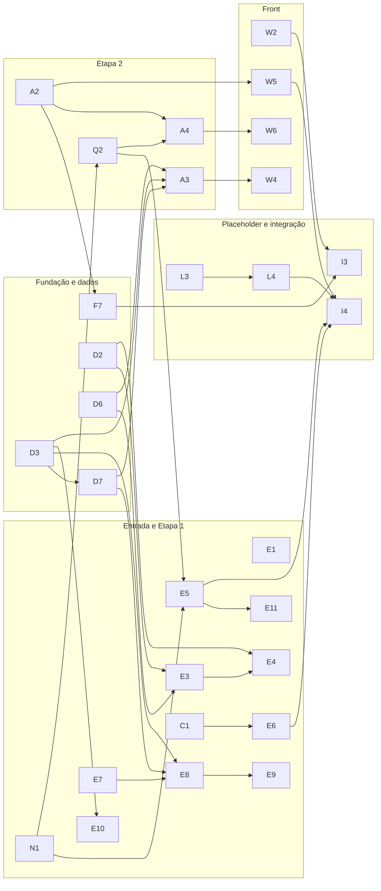

# Próximos passos · Módulo de Marketing

Plano de trabalho a partir do alicerce criado em 25/09/2026, **revisado em 05/11/2026** depois do alinhamento com os contratos do Landing e do CRM: o Landing é o dono dos formulários, os eventos dele não trazem mais a etapa do funil e quem cria a oportunidade no CRM é o Landing (norteador, seção 12). Atualizado em 06/11/2026 com o fechamento da fase 1 (F4, F5, F6, Q1, W1, L1, L2, L5 e I2).

O repositório já tem:

- a API subindo com envelope, segurança por JWT, `/health`, Flyway e Swagger;
- a entidade base com as sete colunas, o filtro por tenant e a paginação (F2);
- o publicador de eventos com envio depois do commit (F3);
- as filas `marketing.landing-leads` e `marketing.crm-oportunidades`, com DLQ, e a base de consumo idempotente (F4);
- o cliente HTTP para o Landing, o CRM e o identity, com token de serviço (F5);
- a infra de testes com Postgres e RabbitMQ no Testcontainers e WireMock dos outros módulos (F6);
- as tabelas de leads, timeline e consentimentos (D1), já ajustadas ao contrato do Landing (D8), e as de qualificação (D5);
- o motor de pontuação (Q1);
- as variáveis de ambiente com os nomes do compose da plataforma (F8);
- o front com layout, abas, camada da casca, cliente HTTP e os componentes do Design System (W1);
- o placeholder do Landing com a página, o formulário de exemplo, o chatbot e os dois eventos (L1, L2), e o stub do CRM (L5);
- o CI que testa e publica as imagens (I2);
- o ambiente local em Docker.

Cada pasta tem um README com o que já existe: [marketing-api](marketing-api/README.md), [marketing-web](marketing-web/README.md), [landing-web](landing-web/README.md), [crm-stub](crm-stub/README.md) e [infra](infra/README.md).

A referência de **o quê** fazer é o [documento norteador](Docs/documento-norteador.md). Este arquivo organiza **em que ordem** fazer e **o que depende do quê**. Se os dois divergirem, vale o norteador.

## Como ler

- Cada tarefa tem um código: **F** fundação do back, **D** dados (migrations), **E** entrada de leads e Etapa 1, **C** CRM, **N** notificações, **Q** qualificação, **A** APIs da Etapa 2, **W** front, **L** placeholder do Landing, **I** integração e entregas.
- **Bloqueado por:** o que precisa estar pronto antes de começar a tarefa. Tarefas concluídas não aparecem mais como bloqueio.
- **Bloqueia:** o que só pode começar depois que a tarefa terminar.
- **X1, X2...** são dependências **de outros grupos ou decisões ainda abertas**. Elas estão na [lista de dependências externas](#dependências-externas-e-decisões-em-aberto).
- **(parcial)** quer dizer que dá para começar antes: por exemplo, programar contra o contrato publicado e ajustar quando o outro grupo responder.
- **[cancelada]** saiu do plano com a revisão de 05/11; o código fica para o histórico.
- A coluna **§** aponta a seção do norteador com os detalhes.

## Visão geral das ondas

Tarefas da mesma onda podem ser feitas **ao mesmo tempo**, por pessoas diferentes. Uma onda só depende das anteriores e do que já está concluído.

| Onda | Tarefas | O que destrava |
|---|---|---|
| **0** · sem dependência pendente | D2, D3, N1, E1, E7, A2 (e D6 assim que X6 for resolvida; W2 assim que X9 for; C1 assim que X2 for; L3 assim que X10 for) | a etapa 1 do chatbot, as notificações, a API de leads e as tabelas de e-mail |
| **1** | D7, E3, E6, E10, Q2, F7, W5, L4 | os valores iniciais, o webhook do Meta, a ligação com a oportunidade, o rodízio e a tela de leads |
| **2** | E4, E5, E8, A3, A4, I3 | o envio (etapa 3), a boas-vindas, as configurações, o painel e a entrega na plataforma |
| **3** | E9, E11, W4, W6, I4 | o aquecimento, a leitura pendente, as telas de Configurações e Painel e o teste de ponta a ponta |

**Caminhos críticos.** As cadeias mais longas têm 4 passos:

```
N1 → Q2 → E5 → I4           lead do envio até o vendedor
N1 → Q2 → A4 → W6           painel
D3 → D7 → A3 → W4           configurações
D3 → D7 → E8 → E9           boas-vindas e aquecimento
L3 → L4 → I4                jornada completa no ambiente local, com o placeholder
```

**Mais urgentes:** **N1**, que destrava o rodízio (Q2) e o envio (E5), e **D3**, que está em dois caminhos críticos. A **E1** já pode começar: as filas, a infra de testes e o motor de pontuação estão prontos.

## Divisão sugerida em trilhas

Cada trilha pode ser de uma pessoa ou dupla.

| Trilha | Tarefas | Começa por |
|---|---|---|
| **1 · Back: fundação e dados** | F7, D2, D3, D6, D7 | D3 |
| **2 · Back: entrada de leads e Etapa 1** | E1, E3–E11, C1, N1 | E1 e N1 |
| **3 · Back: Etapa 2 (qualificação e APIs)** | Q2, A2–A4 | A2 (e Q2 depois da N1) |
| **4 · Front** | W2, W4–W6 | W5 (com dados fictícios até a A2) |
| **5 · Placeholder, integração e entregas** | L3, L4, I3, I4 | decidir a X10 e fechar a L3 |
| **Articulação com outros grupos** | X1–X15 | enviar logo X1 e X2, porque eles demoram |

## Tarefas

### Fundação do back-end (F)

| ID | Tarefa | Bloqueado por | Bloqueia | § |
|---|---|---|---|---|
| **F1** | **[concluída]** Ler do JWT o `tenant_id`, o `sub` (usuário) e as permissões, e transformar as permissões em *authorities* para o `@PreAuthorize`. Criar um jeito único de obter o tenant e o usuário atuais | — | — | 1, 6 |
| **F2** | **[concluída]** Classe base das entidades com as sete colunas, *soft delete* e filtro automático por tenant. Resposta paginada padrão `{itens, pagina, tamanho, total}` | — | — | 3, 6 |
| **F3** | **[concluída]** Publicador de eventos: envelope da §9.7, propriedade `user_id = mq_marketing` e envio **só depois do commit** | — | — | 8 |
| **F4** | **[concluída]** Base de consumo: filas `marketing.landing-leads` (ligada a `landing.eventos` por `landing.formulario.recebido` e `landing.chatbot.lead_capturado`) e `marketing.crm-oportunidades` (ligada a `crm.eventos` por `crm.oportunidade.criada`), declaradas pela API, cada uma com a DLQ `.dlq` (via `marketing.dlx`) depois de 3 tentativas; conferência do envelope e de `user_id = mq_<moduloOrigem>`; consumo idempotente com `eventos_processados` na mesma transação do efeito (`ConsumoDeEventos`, `TopologiaDeConsumo`) | — | — | 8 |
| **F5** | **[concluída]** Cliente HTTP para outros módulos (`compartilhado/http`): token de serviço (`clientId = marketing`) em cache, `X-Tenant-Id`, timeout de 3 s, uma nova tentativa depois de `401`, endereço por variável de ambiente (`LANDING_BASE_URL`, `CRM_BASE_URL`, `IDENTITY_BASE_URL`), chamando direto pelo nome do container; falha vira `FalhaNaChamadaDeModulo` | — | — | 6 |
| **F6** | **[concluída]** Infra de testes (`compartilhado/teste`): `IntegracaoDeTeste` com Postgres e RabbitMQ no Testcontainers e WireMock para Landing, CRM, identity e Graph API do Meta (`ModulosSimulados`, `Envelopes`) | — | — | 10 |
| **F7** | Testes do checklist da plataforma: `403` sem permissão, cabeçalho de 32 KB, `404` para lead de outro tenant e `tenantId` do corpo ignorado | A2 | I3 | 10 |
| **F8** | **[concluída]** Variáveis de ambiente com os nomes do `docker-compose.yml` da plataforma (`SERVER_PORT`, `DB_URL`, `DB_APP_USER`, `DB_OWNER_USER`, `RABBITMQ_USER`, `JWKS_URI`...), no `application.yml`, no compose local e nos READMEs (PR #16) | — | — | 1 |

### Dados: migrations do Flyway (D)

Uma migration por tarefa, com o número fixo da tabela abaixo. Todas com as sete colunas obrigatórias e os tipos da seção 3 do norteador.

O número da migration é da tarefa, não da ordem de merge: cada tarefa sai numa branch própria e os PRs podem entrar fora de ordem. Na plataforma e nos testes o banco sobe do zero e aplica tudo em ordem. No banco local, o perfil `dev` liga o `out-of-order` do Flyway para aplicar uma versão menor que chegou depois (ver o [README da API](marketing-api/README.md#banco-e-migrations)).

| ID | Tarefa | Bloqueado por | Bloqueia | § |
|---|---|---|---|---|
| **D1** | **[concluída]** `V2`: `leads`, `lead_eventos` e `lead_consentimentos` | — | — | 3 |
| **D2** | `V3`: `leads_entrada_buffer`, **só para o Meta**: `meta_lead_id` obrigatório e único por tenant, `payload_bruto` só com os ids do webhook (sem dado pessoal) | — | E3, E4 | 3 |
| **D3** | `V4`: `modelos_mensagem`, `lead_comunicacoes` e `ciclo_vida_configuracoes` | — | D7, E8, E10, A3 | 3 |
| **D4** | **[cancelada]** `V5`: `formularios` e `formulario_versoes`. O formulário é do Landing; o PR #12 foi fechado. O número `V5` fica sem uso | — | — | 9.5 |
| **D5** | **[concluída]** `V6`: `regras_pontuacao` (com `formulario_id` e `campo_id` do Landing e a fonte `campo_meta`), `qualificacao_configuracoes` e `vendedores_rodizio` | — | — | 3, 9.3 |
| **D6** | `V7`: `canais_anuncio`, com os segredos do Meta cifrados e nunca devolvidos pela API, sem `mapeamentoCampos` | X6 | E3, A3 | 3, 9.4 |
| **D7** | Valores iniciais por tenant: modelo de boas-vindas padrão, as regras de pontuação de `utm` da matriz da 9.3 (as de campo dependem dos formulários do tenant), configurações de qualificação e de ciclo de vida. Criados na primeira vez que o tenant usa o módulo | D3 | E8, A3 | 3, 9.3 |
| **D8** | **[concluída]** `V8`: ajusta a `V2` ao contrato do Landing. Em `leads`: `sessao_id` (único por tenant) no lugar de `visitante_id`, `canal`, `envio_lido_em`, `envio_id` único por tenant; sai `formulario_versao`. Em `lead_consentimentos`: `sessao_id`, `texto_termo` no lugar de `versao_termo`, origens `landing.formulario.recebido`, `landing.chatbot.lead_capturado` e `descadastro`; sai `formulario_versao`. Em `lead_eventos`: `respostas_lidas` no lugar de `formulario_atualizado`. Ajusta `Lead`, `LeadConsentimento`, `OrigemConsentimento`, `TipoEventoLead`, os repositórios e os testes | — | — | 3 |

### Entrada de leads e Etapa 1 (E, C, N)

Os consumidores (E1, E5, E6) usam `@RabbitListener(queues = TopologiaDeConsumo.FILA_...)` e chamam `ConsumoDeEventos.consumir(...)`; as chamadas ao Landing e ao CRM partem de `ClientesDeModulos`; a pontuação é `PontuacaoDeLeads.pontuar(lead)`. Cada consumidor grava a UTM no lead antes de pontuar (a `Lead` ainda não tem esse método).

| ID | Tarefa | Bloqueado por | Bloqueia | § |
|---|---|---|---|---|
| **E1** | Consumir `landing.chatbot.lead_capturado` (etapa 1), na chegada: identidade por `sessao_id`, depois e-mail ou telefone normalizados; grava contato, UTM e consentimento; pontua só com as regras de `utm` | — | — | 5 |
| **E2** | **[cancelada]** Drenagem do buffer para os eventos das etapas 0 e 1 do Landing. Os eventos do Landing são processados na chegada; o buffer ficou só para o Meta (E4) | — | — | 4.1 |
| **E3** | Webhook público do Meta: handshake (`hub.challenge`), validação HMAC com o segredo do tenant, resolução do tenant pelo subdomínio e gravação no buffer | D2, D6, X4 | E4 | 6 |
| **E4** | Job 4.1, leads do Meta: busca os dados na Graph API (`META_GRAPH_BASE_URL`), resolve a identidade, grava em `leads` na etapa 0 e pontua com as regras `campo_meta` e `utm`. Decidir onde guardar as respostas do Meta: sem elas, uma nova pontuação (por exemplo, na E5) deixa de somar as regras `campo_meta` | E3, X5 | — | 4.1 |
| **E5** | Consumir `landing.formulario.recebido` (etapa 3), na chegada: identidade por `envio_id`, `sessao_id`, `crm_contato_id` e e-mail/telefone; grava os ids do CRM; lê `GET /api/landing/envios/{id}` (respostas, origem e consentimento); faz o merge de leads duplicados; pontua com as regras do formulário; atribui vendedor; notifica. Com o Landing fora do ar, deixa a leitura pendente | Q2, N1, X1 (parcial) | E11, I4 | 5 |
| **E6** | Consumir `crm.oportunidade.criada` (só `origem = landing`): acha o lead por `envio_id = origemModuloId` ou `crm_contato_id`, cria o lead se o evento chegou antes do envio, grava `crm_oportunidade_id` e `handoff_crm` e leva o vendedor como responsável (C1) | C1 (parcial), X1 (parcial) | I4 | 5, 9.6 |
| **E7** | Descadastro público: `GET /public/marketing/descadastro/{token}` mostra a confirmação, e o `POST` efetiva o opt-out e grava a revogação (com IP e *User-Agent*) em `lead_consentimentos` | — | E8 | 6 |
| **E8** | Envio de e-mail por SMTP (Mailpit local) e job de boas-vindas (4.5): uma vez por lead, para quem enviou o formulário, sempre com o link de descadastro | D3, D7, E7, X3 (parcial) | E9 | 4.5 |
| **E9** | Job de aquecimento (4.2): cadência de e-mails para as etapas 0 e 1 com consentimento; confere o opt-out antes de enviar e esgota ao fim da sequência | E8, X11 (parcial) | — | 4.2 |
| **E10** | Job de anonimização LGPD (4.3): zera os dados pessoais depois do prazo de retenção e nunca apaga a linha | D3 | — | 4.3 |
| **E11** | Job 4.6, leitura pendente do envio: a cada minuto, relê no Landing os envios que não responderam, pontua e atribui; desiste depois de 10 falhas | E5 | — | 4.6 |
| **C1** | Cliente do CRM: gravar o responsável da oportunidade, isolado numa classe só, contra a ação que o CRM definir. Hoje só existe o `PUT` completo da oportunidade | X2 | E6 | 6 |
| **N1** | Pedidos à plataforma em `identity.entrada`: notificação `NOVO_LEAD` e registro na timeline | — | E5, Q2 | 8 |

### Etapa 2: qualificação e APIs (Q, A)

| ID | Tarefa | Bloqueado por | Bloqueia | § |
|---|---|---|---|---|
| **Q1** | **[concluída]** Motor de pontuação (`MotorDePontuacao`, `PontuacaoDeLeads`): soma as regras ativas que valem para o lead (as de campo só do `formulario_id` dele, as de `campo_meta` para o Meta e as de `utm` para todos), cada critério uma vez, valendo a de mais pontos; define a faixa pelos limites do tenant (padrão `mql_quente` ≥ 70, `mql_morno` 40–69, `nutricao` < 40), grava o detalhe e registra `qualificacao_alterada` na timeline | — | — | 9.3 |
| **Q2** | Rodízio: atribui o vendedor ativo que recebeu há mais tempo; fora do horário comercial, fica "aguardando"; job 4.4 de atribuição pendente; reatribuição manual (`PUT /leads/{id}/vendedor`). Com os testes de 3 leads e 2 vendedores, e de fora do horário | N1, X7 (parcial) | E5, A4 | 9.3, 4.4 |
| **A1** | **[cancelada]** API de formulários. O formulário é do Landing | — | — | 9.5 |
| **A2** | API de leads: lista paginada com filtros (inclusive `canal`), detalhe, `GET /leads/{id}/resumo` e `/leads/resumo?ids=` (sem dado pessoal) e busca global `GET /busca?q=`. O detalhe ganha seções à medida que as outras tarefas ficam prontas | — | F7, A4, W5 | 9.2, 9.6 |
| **A3** | APIs de configuração: canais de anúncio, modelos de mensagem, ciclo de vida, qualificação, regras de pontuação, vendedores do rodízio e `GET /qualificacao/formularios` (formulários do Landing que já trouxeram lead, com o resumo lido no Landing) | D3, D6, D7 | W4 | 9.4 |
| **A4** | API do painel: `GET /painel` com as agregações (cache Caffeine por tenant), sem visitantes, e SSE em `/painel/eventos` | A2, Q2, X8 (parcial) | W6 | 9.1 |

### Front-end (W)

As telas podem começar antes da API ficar pronta, com dados fictícios no formato combinado. Mas só ficam **prontas** quando estiverem ligadas à API de verdade.

| ID | Tarefa | Bloqueado por | Bloqueia | § |
|---|---|---|---|---|
| **W1** | **[concluída]** Componentes do Design System em `components/ui`: `Modal`, `Input`, `Select`, `Textarea`, `FormSection`, `FormField`, `SearchBar`, `FilterBar`, `Pagination`, `ViewToggle`, `DetailField`, `DetailSection`, `Stepper` e `statusBadge`, com os neutros e o tema escuro do `ui/plataforma.css` | — | — | DS |
| **W2** | Integração com a casca real: conferir o formato das mensagens com o `exemplo-modulo`, o tema (`data-tema`) e a altura; esconder as abas sem permissão. Levar os neutros e o `dark:` ao `LayoutModulo` e ao `EmConstrucao` e conferir o `Modal` dentro do iframe (a altura acompanha o conteúdo) | X9 | I3 | 9 |
| **W3** | **[cancelada]** Tela Formulários. A aba saiu do front; as respostas aparecem no detalhe do lead (W5) | — | — | 9.5 |
| **W4** | Tela **Configurações**, com quatro abas: canais de anúncio (segredos do Meta só de escrita e URL do webhook), modelos de mensagem, ciclo de vida, e qualificação e distribuição (regras escolhendo formulário e campo do Landing, ou pergunta do Meta) | A3 | — | 9.4 |
| **W5** | Tela **Leads**: lista com filtros e paginação; detalhe em modal com contato, consentimentos, respostas lidas do Landing, pontuação, timeline, e-mails e CRM. Vai precisar de `Tabs` (e talvez `Spinner` e `EmptyState`), que existem na casca mas não estavam na lista da W1 | A2 | I4 | 9.2 |
| **W6** | Tela **Painel**: funil, qualificação, série temporal, campanhas, canais, distribuição e leads recentes, com atualização por SSE | A4 | — | 9.1 |

### Placeholder do Landing (L)

O placeholder imita o **contrato publicado do Landing** (`landing.yaml` e `landing.asyncapi.yaml` do infra), não mais a nossa proposta antiga.

| ID | Tarefa | Bloqueado por | Bloqueia | § |
|---|---|---|---|---|
| **L1** | **[concluída]** Página: guarda UTM, `fbclid` e `gclid` da URL (primeira e última origem) e mostra um formulário de exemplo definido no próprio placeholder (`server/formulario.ts`), com o aceite de consentimento; rotas públicas `GET /public/landing/formularios/{chave}` e `POST .../envios` | — | — | 06* |
| **L2** | **[concluída]** Publica `landing.formulario.recebido` e `landing.chatbot.lead_capturado` em `landing.eventos` como `mq_landing`, com o envelope da §9.7 e os campos do `landing.asyncapi.yaml`; widget de chatbot com as rotas de sessão do contrato | — | — | 06* |
| **L3** | Gravar os envios e expor `GET /api/landing/envios/{id}` e `GET /api/landing/formularios/{id}/resumo` no formato do `landing.yaml`. **Já adiantada na L2:** as rotas respondem, com os envios em memória e `X-Tenant-Id`; falta decidir a X10 (memória ou arquivo, e conferir ou não o token do `marketing`) | X10 | L4 | 06* |
| **L4** | No envio, chamar o stub do CRM (`CRM_BASE_URL`, empresa, contato e oportunidade, com `origemModuloId = envioId`) antes de publicar o evento | L3 | I4 | 06* |
| **L5** | **[concluída]** Stub do CRM em `crm-stub/` (serviço `crm`, porta 8082, como o CRM real): `POST /api/crm/empresas`, `/contatos` e `/oportunidades` em memória por tenant, e publicação de `crm.oportunidade.criada` em `crm.eventos` como `mq_crm` | — | — | 06* |

\* Contexto do ambiente local, fora do norteador: resumo no [README do landing-web](landing-web/README.md), no [README do crm-stub](crm-stub/README.md) e o contrato em [Docs/contratos/landing-requisitos.md](Docs/contratos/landing-requisitos.md).

### Integração e entregas (I)

| ID | Tarefa | Bloqueado por | Bloqueia | § |
|---|---|---|---|---|
| **I1** | **[concluída]** Contratos no infra: `marketing.yaml` 0.2.0 (saúde, busca e resumo do lead) e `marketing.asyncapi.yaml` sem mensagens (PR #29 do infra). Daqui em diante, manter as cópias de `Docs/contratos/` iguais e publicar um evento só quando ele tiver consumidor | — | — | 10 |
| **I2** | **[concluída]** CI (`.github/workflows/ci.yml`): testa a API e o front em todo PR e, no push na `main`, publica `ghcr.io/mateusbarnabe/marketing` e `marketing-front` com o workflow reutilizável `publicar-imagem.yml`. Depois do primeiro push, deixar os dois pacotes públicos no GitHub | — | — | 10 |
| **I3** | Entrega no `infra-integrador-2026`: variáveis de imagem no `.env.example` (`IMAGEM_MARKETING=ghcr.io/mateusbarnabe/marketing:latest`, `IMAGEM_MARKETING_FRONT=ghcr.io/mateusbarnabe/marketing-front:latest`), seguidas da sessão do checklist (19 itens) com o Grupo 2. Contratos, permissões e menu já estão lá | F7, W2, X14 (parcial) | — | 10 |
| **I4** | Teste de ponta a ponta no ambiente local: anúncio → formulário no placeholder → empresa, contato e oportunidade no stub do CRM → eventos → lead → pontuação → vendedor → oportunidade ligada → lead visível na tela | E5, E6, L4, W5 | — | — |

## Dependências externas e decisões em aberto

Estas não se resolvem programando: precisam de resposta de outro grupo, dos professores ou de uma decisão do Grupo 4. A lista completa está na seção 11 do norteador.

| ID | O que falta | Com quem | Bloqueia |
|---|---|---|---|
| **X1** | `sessaoId` em `landing.formulario.recebido`; confirmação de que o Landing cria a oportunidade, com `origemModuloId = envioId` ([landing-requisitos.md](Docs/contratos/landing-requisitos.md)) | Grupo 7 | E5, E6 (parcial: seguimos o contrato publicado e ligamos por `contatoId`) |
| **X2** | Ação no CRM para gravar o responsável da oportunidade, com `servicos: [marketing]` | Grupo 6 | C1 |
| **X3** | Variáveis de SMTP para o `marketing` no compose da plataforma e o provedor de e-mail fora do desenvolvimento | Grupo 2, professores | E8 (parcial: Mailpit local) |
| **X4** | Exceção ao envelope para o `hub.challenge` do Meta (texto puro) e o rate limit de 120/min em `/public/**` | Grupo 2 | E3 |
| **X5** | Token da página do Meta e saída do container para a internet (Graph API) | Grupo 4, Grupo 2 | E4 |
| **X6** | Onde guardar os segredos do Meta por tenant (proposta: colunas cifradas em `canais_anuncio`) | Grupo 4 | D6 |
| **X7** | Listar usuários com perfil VENDEDOR no identity | Grupo 2 | Q2 (parcial: cadastro manual dos ids) |
| **X8** | SSE passando pelo gateway (regra de `504` em 3 s) | Grupo 2 | A4 (parcial: polling como alternativa) |
| **X9** | Se a casca usa o `itensSubmenu` do `modulos/marketing.json` para desenhar subitens na sidebar (o front já tem as abas) | Grupo 2 | W2 |
| **X10** | Placeholder: onde guardar os envios (memória ou arquivo) e se ele confere o token de serviço do `marketing` | Grupo 4 | L3 |
| **X11** | Consentimento dos leads do Meta antes do aquecimento; se o aceite do Landing vale para o aquecimento; destinatário da notificação quando não há vendedor; acesso do vendedor ao lead notificado | Grupo 4, professores | E9 (parcial); influencia Q2 e N1 |
| **X12** | Uma fonte para a etapa 2 do funil (preenchimento parcial) | Grupo 7 | — (a etapa 2 fica zerada) |
| **X13** | IP e *User-Agent* do aceite no consentimento do envio | Grupo 7 | — (a evidência fica incompleta) |
| **X14** | `LANDING_BASE_URL` e `CRM_BASE_URL` no serviço `marketing` do compose da plataforma (hoje valem os padrões `http://landing:8088` e `http://crm:8082`) | Grupo 2 | I3 (parcial: os padrões já apontam para os nomes dos containers) |
| **X15** | Campos para `fbclid` e `gclid` no `ToqueOrigem` do envio; hoje eles só chegam dentro de `paginaEntrada` | Grupo 7 | — (parcial: o Marketing pode extrair da URL) |

## Mapa das dependências internas

Uma seta `A --> B` quer dizer que **A bloqueia B**. As tarefas concluídas e canceladas e as dependências externas (X) ficaram de fora para o desenho não poluir.



## Ao terminar uma tarefa

- Branch própria (`feat/...`, `fix/...`, `docs/...`) e PR para a `main`; commits no formato `<tipo>(<contexto>): <descrição>`.
- Se a tarefa mudou o desenho (tabela, rota, permissão ou evento), atualize o norteador no mesmo PR, incluindo o registro de alterações (seção 12).
- Atualize o README da pasta, se a estrutura ou as classes mudaram, e marque a tarefa aqui como feita.
