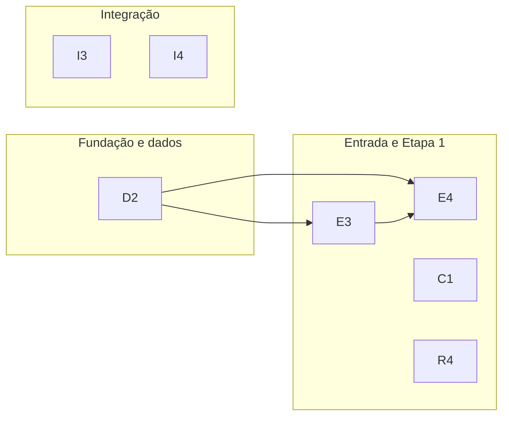

# Próximos passos · Módulo de Marketing

Plano de trabalho a partir do alicerce criado em 25/09/2026, **revisado em 05/11/2026** depois do alinhamento com os contratos do Landing e do CRM: o Landing é o dono dos formulários, os eventos dele não trazem mais a etapa do funil e quem cria a oportunidade no CRM é o Landing (norteador, seção 12). Atualizado em 06/11/2026 com o fechamento da fase 1 (F4, F5, F6, Q1, W1, L1, L2, L5 e I2) e da fase 2, "lead qualificado e ligado ao CRM" (N1, Q2, E1, A2, L3, L4, E5, E6 e E11). Atualizado em 09/11/2026 com o ponto de IoT, o "lead 0" (R1 a R3), e a parte essencial da tela Leads (W5). Atualizado em 18/11/2026 com o PR #22 (D3, D6, D7, E7 a E10, A3, W4 e R5) e com a rodada 1 da fase 3: o painel (A4, W6 e R6), a integração com a casca real (W2), a tela Leads completa (W5) e os testes do checklist da plataforma (F7). Atualizado em 19/11/2026 com a rodada 2 da fase 3: os leads do Meta (D2, E3 e E4), a localização real por IP (R4) e o teste de ponta a ponta (I4).

O repositório já tem:

- a API subindo com envelope, segurança por JWT, `/health`, Flyway e Swagger;
- a entidade base com as sete colunas, o filtro por tenant e a paginação (F2);
- o publicador de eventos com envio depois do commit (F3);
- as filas `marketing.landing-leads` e `marketing.crm-oportunidades`, com DLQ, e a base de consumo idempotente (F4);
- o cliente HTTP para o Landing, o CRM e o identity, com token de serviço (F5);
- a infra de testes com Postgres e RabbitMQ no Testcontainers e WireMock dos outros módulos (F6);
- as tabelas de leads, timeline e consentimentos (D1), já ajustadas ao contrato do Landing (D8), e as de qualificação (D5);
- a jornada do lead de ponta a ponta no back: captura do chatbot na etapa 1 (E1), envio do formulário na etapa 3 com leitura do envio no Landing e junção de duplicados (E5), ligação com a oportunidade do CRM (E6) e o job de leitura pendente (E11);
- o motor de pontuação (Q1), o rodízio de vendedores com o job de atribuição pendente (Q2) e as notificações e a timeline na plataforma (N1);
- a API de leads: lista, detalhe, resumo e busca (A2);
- as variáveis de ambiente com os nomes do compose da plataforma (F8);
- o front com layout, abas, camada da casca, cliente HTTP e os componentes do Design System (W1);
- o placeholder do Landing com a página, o formulário de exemplo, o chatbot, os dois eventos, a leitura do envio e a criação de empresa, contato e oportunidade no stub do CRM (L1 a L5);
- o CI que testa e publica as imagens (I2);
- o rastreamento do clique no anúncio, o "lead 0" (R1 a R3): link de campanha, script na landing page, ligação da visita ao lead no envio, pontuação por comportamento, descarte no prazo e a aba Rastreamento em Configurações;
- a comunicação, o ciclo de vida e as configurações (PR #22): descadastro, boas-vindas, aquecimento, anonimização, canais de anúncio com segredos cifrados, modelos de mensagem, valores iniciais, APIs de configuração e a tela Configurações (D3, D6, D7, E7 a E10, A3, W4 e R5);
- a tela Leads completa (W5): lista com filtros de campanha, vendedor e período, detalhe em abas, reatribuição do vendedor, histórico de consentimentos e resumos do CRM;
- o painel (A4, W6 e R6): `GET /painel` com cache, o fluxo SSE `/painel/eventos`, a tela com o cartão do lead 0 e a atualização em tempo real (`V12`);
- a integração com a casca real (W2): sessão, tema, abas por permissão, aviso à casca e modal dentro do iframe;
- os testes do checklist da plataforma (F7), em `conformidade/ChecklistDaPlataformaTest`;
- os leads do Meta Ads (D2, E3 e E4): buffer (`V3`), webhook público com handshake e HMAC, job 4.1 que busca na Graph API, cria o lead na etapa 0, pontua e atribui, e as respostas do formulário em `leads.respostas_meta` (`V13`);
- a localização por IP real (R4): `LocalizacaoPorGeoIp`, com base GeoLite2 City local, ligada por `RASTREAMENTO_GEOIP_ARQUIVO`;
- o teste de ponta a ponta (I4): `scripts/ponta-a-ponta.mjs` e `Docs/roteiro-ponta-a-ponta.md`, executado em 19/11 com 64 conferências e 0 falhas;
- o ambiente local em Docker.

Cada pasta tem um README com o que já existe: [marketing-api](marketing-api/README.md), [marketing-web](marketing-web/README.md), [landing-web](landing-web/README.md), [crm-stub](crm-stub/README.md) e [infra](infra/README.md).

A referência de **o quê** fazer é o [documento norteador](Docs/documento-norteador.md). Este arquivo organiza **em que ordem** fazer e **o que depende do quê**. Se os dois divergirem, vale o norteador.

## Como ler

- Cada tarefa tem um código: **F** fundação do back, **D** dados (migrations), **E** entrada de leads e Etapa 1, **C** CRM, **N** notificações, **Q** qualificação, **A** APIs da Etapa 2, **W** front, **L** placeholder do Landing, **R** rastreamento do anúncio (IoT), **I** integração e entregas.
- **Bloqueado por:** o que precisa estar pronto antes de começar a tarefa. Tarefas concluídas não aparecem mais como bloqueio.
- **Bloqueia:** o que só pode começar depois que a tarefa terminar.
- **X1, X2...** são dependências **de outros grupos ou decisões ainda abertas**. Elas estão na [lista de dependências externas](#dependências-externas-e-decisões-em-aberto).
- **(parcial)** quer dizer que dá para começar antes: por exemplo, programar contra o contrato publicado e ajustar quando o outro grupo responder.
- **[cancelada]** saiu do plano com a revisão de 05/11; o código fica para o histórico.
- A coluna **§** aponta a seção do norteador com os detalhes.

## Visão geral das ondas

Tarefas da mesma onda podem ser feitas **ao mesmo tempo**, por pessoas diferentes. Uma onda só depende das anteriores e do que já está concluído.

| Onda | Tarefas | O que destrava |
|---|---|---|
| **0** · sem dependência pendente | I3 (e C1 assim que X2 for) | a entrega na plataforma (com o checklist) |

Sobram só tarefas que dependem de outros grupos: a I3 (Grupo 2) e a C1 (Grupo 6).

**Mais urgente:** **I3**, a entrega no `infra-integrador-2026`, que fecha o checklist de 19 itens com o Grupo 2 (F7 e W2 estão prontas; a X14 bloqueia só em parte). Junto vão o ajuste `MAIL_*` → `SMTP_*` e os pedidos que o Meta traz (gateway para `/public/marketing/**`, saída para `graph.facebook.com`, base GeoLite2 no container).

## Divisão sugerida em trilhas

Cada trilha pode ser de uma pessoa ou dupla.

| Trilha | Tarefas | Começa por |
|---|---|---|
| **1 · Back: fundação e dados** | — (D2 pronta) | — |
| **2 · Back: entrada de leads e Etapa 1** | C1 | C1, quando a X2 for resolvida |
| **3 · Back: Etapa 2 (qualificação e APIs)** | — (A2 a A4 prontas) | — |
| **4 · Front** | — (W1 a W6 prontas) | — |
| **5 · Placeholder, integração e entregas** | I3 | I3, com o checklist (I4 pronta) |
| **Articulação com outros grupos** | X1–X16 | enviar logo X1 e X2, porque eles demoram |

## Tarefas

### Fundação do back-end (F)

| ID | Tarefa | Bloqueado por | Bloqueia | § |
|---|---|---|---|---|
| **F1** | **[concluída]** Ler do JWT o `tenant_id`, o `sub` (usuário) e as permissões, e transformar as permissões em *authorities* para o `@PreAuthorize`. Criar um jeito único de obter o tenant e o usuário atuais | — | — | 1, 6 |
| **F2** | **[concluída]** Classe base das entidades com as sete colunas, *soft delete* e filtro automático por tenant. Resposta paginada padrão `{itens, pagina, tamanho, total}` | — | — | 3, 6 |
| **F3** | **[concluída]** Publicador de eventos: envelope da §9.7, propriedade `user_id = mq_marketing` e envio **só depois do commit** | — | — | 8 |
| **F4** | **[concluída]** Base de consumo: filas `marketing.landing-leads` (ligada a `landing.eventos` por `landing.formulario.recebido` e `landing.chatbot.lead_capturado`) e `marketing.crm-oportunidades` (ligada a `crm.eventos` por `crm.oportunidade.criada`), declaradas pela API, cada uma com a DLQ `.dlq` (via `marketing.dlx`) depois de 3 tentativas; conferência do envelope e de `user_id = mq_<moduloOrigem>`; consumo idempotente com `eventos_processados` na mesma transação do efeito (`ConsumoDeEventos`, `TopologiaDeConsumo`) | — | — | 8 |
| **F5** | **[concluída]** Cliente HTTP para outros módulos (`compartilhado/http`): token de serviço (`clientId = marketing`) em cache, `X-Tenant-Id`, timeout de 3 s, uma nova tentativa depois de `401`, endereço por variável de ambiente (`LANDING_BASE_URL`, `CRM_BASE_URL`, `IDENTITY_BASE_URL`), chamando direto pelo nome do container; falha vira `FalhaNaChamadaDeModulo` | — | — | 6 |
| **F6** | **[concluída]** Infra de testes (`compartilhado/teste`): `IntegracaoDeTeste` com Postgres e RabbitMQ no Testcontainers e WireMock para Landing, CRM, identity e Graph API do Meta (`ModulosSimulados`, `Envelopes`) | — | — | 10 |
| **F7** | **[concluída]** Testes do checklist da plataforma em `conformidade/ChecklistDaPlataformaTest`, um teste por item (`itemNN_...`): health sem token (2), `401` (3), `403` em 25 rotas (4), `404` de outro tenant (5), `tenantId` do corpo, da query e do cabeçalho ignorado (6), sete colunas (7), nenhuma FK para outro schema (8), envelope em todos os códigos e nas rotas públicas (9), listas com tamanho máximo 100 (10), migrations com `own_marketing` e app com `usr_marketing` (16) e cabeçalho de 32 KB com o Tomcat de verdade (19); os itens 17 e 18 já eram cobertos por `PublicadorDeEventosTest` e `ConsumoDeEventosIntegracaoTest`. O teste achou duas falhas de produção, já corrigidas em `TratadorDeErros`: `Content-Type` não suportado agora responde `415` e `Accept` que a API não produz responde `406`, ambos com envelope | — | — | 10 |
| **F8** | **[concluída]** Variáveis de ambiente com os nomes do `docker-compose.yml` da plataforma (`SERVER_PORT`, `DB_URL`, `DB_APP_USER`, `DB_OWNER_USER`, `RABBITMQ_USER`, `JWKS_URI`...), no `application.yml`, no compose local e nos READMEs (PR #16) | — | — | 1 |

### Dados: migrations do Flyway (D)

Uma migration por tarefa, com o número fixo da tabela abaixo. Todas com as sete colunas obrigatórias e os tipos da seção 3 do norteador. Fora das tarefas D, a fase 2 usou a `V9` (Q2: índice dos leads aguardando vendedor) e a `V10` (E5/E11: colunas e índice da leitura pendente do envio), e o IoT usou a `V11` (R1: rastreamento do anúncio) e o painel usou a `V12` (A4: índice `ix_lead_eventos_tenant_sequencia` do fluxo SSE); a D2 usou a `V3` e a E4 usou a `V13` (`leads.respostas_meta`); o próximo número livre é o `V14`.

O número da migration é da tarefa, não da ordem de merge: cada tarefa sai numa branch própria e os PRs podem entrar fora de ordem. Na plataforma e nos testes o banco sobe do zero e aplica tudo em ordem. No banco local, o perfil `dev` liga o `out-of-order` do Flyway para aplicar uma versão menor que chegou depois (ver o [README da API](marketing-api/README.md#banco-e-migrations)).

| ID | Tarefa | Bloqueado por | Bloqueia | § |
|---|---|---|---|---|
| **D1** | **[concluída]** `V2`: `leads`, `lead_eventos` e `lead_consentimentos` | — | — | 3 |
| **D2** | **[concluída]** `V3`: `leads_entrada_buffer`, **só para o Meta**: `meta_lead_id` obrigatório e único por tenant, `payload_bruto` só com os ids do webhook (sem dado pessoal) | — | E3, E4 | 3 |
| **D3** | **[concluída]** `V4`: `modelos_mensagem`, `lead_comunicacoes` e `ciclo_vida_configuracoes`, além de permitir zerar `token_descadastro` na anonimização | — | — | 3 |
| **D4** | **[cancelada]** `V5`: `formularios` e `formulario_versoes`. O formulário é do Landing; o PR #12 foi fechado. O número `V5` fica sem uso | — | — | 9.5 |
| **D5** | **[concluída]** `V6`: `regras_pontuacao` (com `formulario_id` e `campo_id` do Landing e a fonte `campo_meta`), `qualificacao_configuracoes` e `vendedores_rodizio` | — | — | 3, 9.3 |
| **D6** | **[concluída]** `V7`: `canais_anuncio`, com os segredos do Meta cifrados (`CifradorDeSegredo`) e nunca devolvidos pela API, sem `mapeamentoCampos` | — | E3 | 3, 9.4 |
| **D7** | **[concluída]** Valores iniciais por tenant (`ValoresIniciaisDoTenant`): modelo de boas-vindas padrão, as regras de pontuação de `utm` da matriz da 9.3 e de `comportamento` (R5), configurações de qualificação, de ciclo de vida e os dois canais de anúncio. As regras iniciais entram também na primeira pontuação de um lead do tenant (`qualificacao/RegrasIniciais`), e o modelo de boas-vindas, no primeiro envio (`comunicacao/ModeloDeBoasVindas`) | — | — | 3, 9.3 |
| **D8** | **[concluída]** `V8`: ajusta a `V2` ao contrato do Landing. Em `leads`: `sessao_id` (único por tenant) no lugar de `visitante_id`, `canal`, `envio_lido_em`, `envio_id` único por tenant; sai `formulario_versao`. Em `lead_consentimentos`: `sessao_id`, `texto_termo` no lugar de `versao_termo`, origens `landing.formulario.recebido`, `landing.chatbot.lead_capturado` e `descadastro`; sai `formulario_versao`. Em `lead_eventos`: `respostas_lidas` no lugar de `formulario_atualizado`. Ajusta `Lead`, `LeadConsentimento`, `OrigemConsentimento`, `TipoEventoLead`, os repositórios e os testes | — | — | 3 |

### Entrada de leads e Etapa 1 (E, C, N)

A entrada fica no pacote `entrada/`: `NormalizacaoDeContato`, `ChavesDeIdentidade`, `IdentificacaoDeLeads`, `GravacaoDeLeads`, `RegistroDeConsentimentos`, `JuncaoDeLeads`, `LeituraDoEnvio` e `TravasDeLeads` são reaproveitados pelas próximas entradas (E3, E4). Os consumidores usam `ConsumoDeEventos.consumir(...)`, as chamadas ao Landing e ao CRM partem de `ClientesDeModulos` e a pontuação é `PontuacaoDeLeads.pontuar(lead)`.

| ID | Tarefa | Bloqueado por | Bloqueia | § |
|---|---|---|---|---|
| **E1** | **[concluída]** Consumir `landing.chatbot.lead_capturado` (etapa 1), na chegada: identidade por `sessao_id`, depois e-mail ou telefone normalizados; grava contato, UTM e consentimento; pontua só com as regras de `utm` (`CapturaDoChatbot`, `ConsumidorDeLeadsDoLanding`) | — | — | 5 |
| **E2** | **[cancelada]** Drenagem do buffer para os eventos das etapas 0 e 1 do Landing. Os eventos do Landing são processados na chegada; o buffer ficou só para o Meta (E4) | — | — | 4.1 |
| **E3** | **[concluída]** Webhook público do Meta: handshake (`hub.challenge`), validação HMAC com o segredo do tenant, resolução do tenant pelo subdomínio (cache de 60 s) e gravação no buffer. Falta só a exceção ao envelope no contrato (X4) | X4 (só o registro) | — | 6 |
| **E4** | **[concluída]** Job 4.1, leads do Meta: busca os dados na Graph API (`META_GRAPH_BASE_URL`), resolve a identidade, grava em `leads` na etapa 0, pontua e atribui pelo rodízio. As respostas do Meta ficam em `leads.respostas_meta` (`V13`). Falta o token da página e a saída do container (X5) para funcionar em produção | X5 (só a operação) | — | 4.1 |
| **E5** | **[concluída]** Consumir `landing.formulario.recebido` (etapa 3), na chegada: lê `GET /api/landing/envios/{id}`, acha o lead por `envio_id`, `sessao_id`, `crm_contato_id` e e-mail/telefone, grava os ids do CRM, contato, respostas, UTM e consentimento, junta os duplicados, pontua e atribui vendedor (`EnvioDoFormulario`). Com o Landing fora do ar, deixa a leitura pendente | — | — | 5 |
| **E6** | **[concluída]** Consumir `crm.oportunidade.criada` (só `origem = landing`): acha o lead por `envio_id = origemModuloId` ou `crm_contato_id`, cria o lead pendente se o evento chegou antes do envio, grava `crm_oportunidade_id` e `handoff_crm` e pede o registro na timeline (`OportunidadeDoCrm`). Levar o vendedor como responsável fica no ponto `crm/ResponsavelDaOportunidade`, para a C1 | — | — | 5, 9.6 |
| **E7** | **[concluída]** Descadastro público (`DescadastroPublicoController`, `DescadastroDeLead`): `GET /public/marketing/descadastro/{token}` mostra a confirmação, e o `POST` efetiva o opt-out e grava a revogação (com IP e *User-Agent*) em `lead_consentimentos`. No navegador, as duas respondem uma página HTML (`PaginaDeDescadastro`), com o botão que faz o `POST` | — | — | 6 |
| **E8** | **[concluída]** Envio de e-mail por SMTP (`EnviadorDeEmail`, Mailpit local) e job de boas-vindas (4.5, `ConfirmacaoDeBoasVindas`): uma vez por lead, para quem enviou o formulário, sempre com o link de descadastro | — | — | 4.5 |
| **E9** | **[concluída]** Job de aquecimento (4.2, `CadenciaDeAquecimento`): cadência de e-mails para as etapas 0 e 1 com consentimento; confere o opt-out antes de enviar e esgota ao fim da sequência | — | — | 4.2 |
| **E10** | **[concluída]** Job de anonimização LGPD (4.3, `AnonimizacaoPorRetencao`): zera os dados pessoais depois do prazo de retenção e nunca apaga a linha | — | — | 4.3 |
| **E11** | **[concluída]** Job 4.6, leitura pendente do envio: a cada minuto, relê no Landing os envios que não responderam, aplica o mesmo fluxo da E5 e desiste depois de 10 falhas seguidas (`LeituraPendenteDoEnvio`, `V10`) | — | — | 4.6 |
| **C1** | Cliente do CRM: gravar o responsável da oportunidade, isolado numa classe só, contra a ação que o CRM definir. Substitui `crm/ResponsavelDaOportunidadePendente`, que hoje só registra a pendência. Chamar também quando o rodízio (Q2 e job 4.4) atribui vendedor a um lead que já tem `crm_oportunidade_id` | X2 | — | 6 |
| **N1** | **[concluída]** Pedidos à plataforma em `identity.entrada`: notificação `NOVO_LEAD` e registro na timeline (`NotificacoesDeLead`, `PedidosAPlataforma`). Sem vendedor, não notifica (ponto único `DestinatarioSemVendedor`, até a X11) | — | — | 8 |

### Etapa 2: qualificação e APIs (Q, A)

| ID | Tarefa | Bloqueado por | Bloqueia | § |
|---|---|---|---|---|
| **Q1** | **[concluída]** Motor de pontuação (`MotorDePontuacao`, `PontuacaoDeLeads`): soma as regras ativas que valem para o lead (as de campo só do `formulario_id` dele, as de `campo_meta` para o Meta e as de `utm` para todos), cada critério uma vez, valendo a de mais pontos; define a faixa pelos limites do tenant (padrão `mql_quente` ≥ 70, `mql_morno` 40–69, `nutricao` < 40), grava o detalhe e registra `qualificacao_alterada` na timeline | — | — | 9.3 |
| **Q2** | **[concluída]** Rodízio (`RodizioDeVendedores`): atribui o vendedor ativo que recebeu há mais tempo e notifica pela N1; fora do horário comercial ou sem vendedor, o lead fica "aguardando"; job 4.4 de atribuição pendente (`AtribuicaoPendente`, `V9`); reatribuição manual (`PUT /leads/{id}/vendedor`). Vendedores cadastrados à mão em `vendedores_rodizio` até a X7; transbordo depende do Grupo 6 | — | — | 9.3, 4.4 |
| **A1** | **[cancelada]** API de formulários. O formulário é do Landing | — | — | 9.5 |
| **A2** | **[concluída]** API de leads (`leads/api`): lista paginada com filtros (inclusive `canal`) e ordenação, detalhe em seções, `GET /leads/{id}/resumo` e `/leads/resumo?ids=` (sem dado pessoal) e busca global `GET /busca?q=`. O nome do vendedor no detalhe espera a X7 | — | — | 9.2, 9.6 |
| **A3** | **[concluída]** APIs de configuração (`ConfiguracoesController`, `FormulariosDaQualificacao`): canais de anúncio, modelos de mensagem, ciclo de vida, qualificação, regras de pontuação, vendedores do rodízio e `GET /qualificacao/formularios` (formulários do Landing que já trouxeram lead, com o resumo lido no Landing) | — | — | 9.4 |
| **A4** | **[concluída]** API do painel (`painel/`, `V12`): `GET /painel` (`marketing.dashboard.ver`; filtros `periodo`, `origem` e `campanha`, com `400` por campo) com funil, qualificação, série temporal, conversão, campanhas, canais com custo estimado, distribuição, leads recentes e o bloco `leadZero` (R6), com cache Caffeine por tenant e filtros (30 s, `marketing.painel.cache`), e o SSE `GET /painel/eventos` (`id = lead_eventos.sequencia`, `Last-Event-ID`, `: ping` a cada 15 s, `lead_zero_atualizado`, limite de 20 conexões por tenant com `429`). Limitação: transação que confirma depois de outra com `sequencia` maior pode não chegar ao fluxo aberto; a releitura do resumo corrige. Resta a X8 (o gateway sustentar a conexão longa) | — | — | 9.1 |

### Front-end (W)

As telas podem começar antes da API ficar pronta, com dados fictícios no formato combinado. Mas só ficam **prontas** quando estiverem ligadas à API de verdade.

| ID | Tarefa | Bloqueado por | Bloqueia | § |
|---|---|---|---|---|
| **W1** | **[concluída]** Componentes do Design System em `components/ui`: `Modal`, `Input`, `Select`, `Textarea`, `FormSection`, `FormField`, `SearchBar`, `FilterBar`, `Pagination`, `ViewToggle`, `DetailField`, `DetailSection`, `Stepper` e `statusBadge`, com os neutros e o tema escuro do `ui/plataforma.css` | — | — | DS |
| **W2** | **[concluída]** Integração com a casca real (`plataforma/` e `LayoutModulo`): trata `plataforma:sessao`, `plataforma:token` e `plataforma:tema`, envia `modulo:notificar`, expõe `temPermissao`, `notificar` e os hooks `usarPermissao` e `usarTemSessao`; esconde as abas sem permissão e mostra "sem acesso" se não houver nenhuma; embutido não há abas internas (a casca abre os itens do `itensSubmenu`); tema escuro pelos neutros; `Modal` centralizado na parte visível do iframe, com a altura incluindo o modal aberto; `scripts/dev-plataforma.ps1 -ComCasca` sobe a casca | — | — | 9 |
| **W3** | **[cancelada]** Tela Formulários. A aba saiu do front; as respostas aparecem no detalhe do lead (W5) | — | — | 9.5 |
| **W4** | **[concluída]** Tela **Configurações**, com as cinco abas completas: rastreamento (R2), canais de anúncio (segredos do Meta só de escrita e URL do webhook), modelos de mensagem (com pré-visualização), ciclo de vida, e qualificação e distribuição (regras escolhendo formulário e campo do Landing, pergunta do Meta, UTM ou comportamento do lead 0) | — | — | 9.4 |
| **W5** | **[concluída]** Tela **Leads**: lista com filtros (busca, etapa, faixa, origem, canal, campanha, vendedor e período, na URL) e paginação, e detalhe em modal (rota `/leads/{id}`, a da busca global) com as abas Dados, Origem, Interação (visita do anúncio, R1), Respostas (inclusive "aguardando Landing" e "indisponíveis"), Pontuação e Timeline; reatribuição do vendedor (`PUT /leads/{id}/vendedor`, botão escondido sem `marketing.qualificacao.editar`, aviso à casca), histórico de consentimentos (IP e *User-Agent* só ali), e-mails enviados (D3) e resumos de empresa e contato buscados no CRM pelo front com o token do usuário (`requisitarModulo('crm', ...)`; falha vira "indisponível no CRM" só naquele campo); `Tabs`, `Spinner` e `EmptyState` entraram no Design System. O nome do vendedor segue indisponível até a X7 (mostra o id encurtado) | — | — | 9.2 |
| **W6** | **[concluída]** Tela **Painel** (`features/painel` e `api/eventos.ts`): filtros, funil, qualificação, série por origem, campanhas, canais com custo "estimado", distribuição, leads recentes com link para o lead, conversão 1 → 3 e o cartão do lead 0 (R6); busca o resumo uma vez e aplica os eventos do SSE localmente, relê a cada 60 s com o fluxo e a cada 30 s sem ele ("Atualização em tempo real indisponível"); `fetch` + `ReadableStream` com reconexão e `Last-Event-ID`; gráficos em SVG e CSS | — | — | 9.1 |

### Placeholder do Landing (L)

O placeholder imita o **contrato publicado do Landing** (`landing.yaml` e `landing.asyncapi.yaml` do infra), não mais a nossa proposta antiga.

| ID | Tarefa | Bloqueado por | Bloqueia | § |
|---|---|---|---|---|
| **L1** | **[concluída]** Página: guarda UTM, `fbclid` e `gclid` da URL (primeira e última origem) e mostra um formulário de exemplo definido no próprio placeholder (`server/formulario.ts`), com o aceite de consentimento; rotas públicas `GET /public/landing/formularios/{chave}` e `POST .../envios` | — | — | 06* |
| **L2** | **[concluída]** Publica `landing.formulario.recebido` e `landing.chatbot.lead_capturado` em `landing.eventos` como `mq_landing`, com o envelope da §9.7 e os campos do `landing.asyncapi.yaml`; widget de chatbot com as rotas de sessão do contrato | — | — | 06* |
| **L3** | **[concluída]** Envios em memória e `GET /api/landing/envios/{id}` e `GET /api/landing/formularios/{id}/resumo` no formato do `landing.yaml`, exigindo `Authorization: Bearer` e `X-Tenant-Id` sem validar a assinatura (X10 resolvida) | — | — | 06* |
| **L4** | **[concluída]** No envio e na conclusão do chatbot, antes de publicar o evento, cria ou reaproveita empresa e contato e cria a oportunidade no stub do CRM (`CRM_BASE_URL`, `origemModuloId = envioId`). O formulário de exemplo ganhou o campo opcional CNPJ; com o CRM fora do ar, o evento sai com os ids nulos | — | — | 06* |
| **L5** | **[concluída]** Stub do CRM em `crm-stub/` (serviço `crm`, porta 8082, como o CRM real): `POST /api/crm/empresas`, `/contatos` e `/oportunidades` em memória por tenant, e publicação de `crm.oportunidade.criada` em `crm.eventos` como `mq_crm` | — | — | 06* |

\* Contexto do ambiente local, fora do norteador: resumo no [README do landing-web](landing-web/README.md), no [README do crm-stub](crm-stub/README.md) e o contrato em [Docs/contratos/landing-requisitos.md](Docs/contratos/landing-requisitos.md).

### Rastreamento do anúncio: o ponto de IoT (R)

Decisão de 09/11/2026 (norteador, seção 12): o IoT do Marketing é o **lead 0**, quem clicou no anúncio e ainda não deixou contato. O dado vem das campanhas: o aparelho de quem clica (contexto técnico) e o que a pessoa faz na landing page (comportamento). Substitui a demo da branch `feat/iot-ingestao-leads`, que fica como histórico; dela vieram o modelo do contexto técnico e do comportamento em `jsonb` e o modal de detalhe.

| ID | Tarefa | Bloqueado por | Bloqueia | § |
|---|---|---|---|---|
| **R1** | **[concluída]** Back do rastreamento (`rastreamento/`, `V11`): link de campanha (`GET /public/marketing/c/{codigo}`, `302` com UTM e `mkt_visita`), sinais do script (`POST /public/marketing/visitas/{id}/sinais`), `rastreamento.js`, ligação da visita ao lead na leitura do envio (`VinculoDeVisitas`, antes da pontuação), fonte `comportamento` nas regras de pontuação, job 4.7 de descarte e as rotas de configuração, links e visitas. Localização por IP simulada (`LocalizacaoSimulada`) | — | — | 2, 3, 4.7, 5, 6 |
| **R2** | **[concluída]** Front: aba Rastreamento em Configurações (resumo de 24 h, configuração e tag do script, links com "Simular clique" e visitas ao vivo com a contagem do descarte) e a aba Interação no detalhe do lead | — | — | 9.2, 9.4 |
| **R3** | **[concluída]** Placeholder do Landing carrega o script do Marketing (`VITE_MARKETING_URL`), tem a seção de preços e os `data-rastreio`, e mostra o `mkt_visita` no rodapé de teste | — | — | 06* |
| **R4** | **[concluída]** Localização por IP real: `LocalizacaoPorGeoIp` com base GeoLite2 City local, `@Primary` só quando `RASTREAMENTO_GEOIP_ARQUIVO` aponta para um arquivo existente. Cada ambiente baixa a base (licença da MaxMind) | — | — | 6 |
| **R5** | **[concluída]** Regras de comportamento na tela de qualificação (W4) e valores iniciais delas (D7) | — | — | 9.3 |
| **R6** | **[concluída]** Painel: bloco `leadZero` (cliques, ativas, convertidas, descartadas, taxa e quebras por campanha e por dispositivo) no `GET /painel`, evento `lead_zero_atualizado` no SSE e o cartão na tela (back e front). A aba Rastreamento de Configurações continua relendo as visitas a cada 5 s | — | — | 9.1 |

### Integração e entregas (I)

| ID | Tarefa | Bloqueado por | Bloqueia | § |
|---|---|---|---|---|
| **I1** | **[concluída]** Contratos no infra: `marketing.yaml` 0.2.0 (saúde, busca e resumo do lead) e `marketing.asyncapi.yaml` sem mensagens (PR #29 do infra). Daqui em diante, manter as cópias de `Docs/contratos/` iguais e publicar um evento só quando ele tiver consumidor | — | — | 10 |
| **I2** | **[concluída]** CI (`.github/workflows/ci.yml`): testa a API e o front em todo PR e, no push na `main`, publica `ghcr.io/mateusbarnabe/marketing` e `marketing-front` com o workflow reutilizável `publicar-imagem.yml`. Depois do primeiro push, deixar os dois pacotes públicos no GitHub | — | — | 10 |
| **I3** | Entrega no `infra-integrador-2026`: variáveis de imagem no `.env.example` (`IMAGEM_MARKETING=ghcr.io/mateusbarnabe/marketing:latest`, `IMAGEM_MARKETING_FRONT=ghcr.io/mateusbarnabe/marketing-front:latest`), seguidas da sessão do checklist (19 itens) com o Grupo 2. Contratos, permissões e menu já estão lá; os testes do checklist (F7) e a integração com a casca (W2) estão prontos | X14 (parcial) | — | 10 |
| **I4** | **[concluída]** Teste de ponta a ponta no ambiente local: `scripts/ponta-a-ponta.mjs` (login, link de campanha, clique, sinais, formulário no placeholder, CRM, lead na etapa 3, pontuação, rodízio, visita convertida, boas-vindas no Mailpit, detalhe e, com `--descarte`, o descarte). Executado em 19/11/2026: 64 conferências, 0 falhas. Roteiro em `Docs/roteiro-ponta-a-ponta.md` | — | — | — |

## Pendências da validação ao vivo (19/11)

O que a validação no navegador (Chrome, contra a plataforma real e a casca) não cobriu ou encontrou e deixou para depois. São do Grupo 4 e não dependem de outro grupo. O que ela cobriu e passou: painel com SSE ao vivo (inclusive pelo gateway), leads (lista, detalhe, consentimento, pontuação, reatribuição), resumos do CRM, configurações, módulo embutido na casca com tema claro e escuro, altura do iframe com o modal aberto (1280×720) e o botão de reatribuir escondido para quem não tem `marketing.qualificacao.editar`.

| ID | O que falta | Como conferir |
|---|---|---|
| **V1** | **Configurações sem permissão de edição.** Quem só tem `marketing.configuracao.ver` (o `gestor@empresa-a.dev`) ainda vê o interruptor "Registrar as visitas", "Novo link" e os ícones de editar e excluir. A API responde `403 Sem permissão para esta ação.`, então é só usabilidade: esconder ou desabilitar com `usarPermissao` (`marketing.configuracao.editar`; `marketing.qualificacao.editar` para regras e escala; `marketing.template.*` para os modelos) | entrar como `gestor@` na casca, abrir Configurações e ver que nada pede uma ação que ele não pode fazer |
| **V2** | **Reconexão do SSE na tela.** Só foram testados a abertura, os eventos ao vivo e 40 s de conexão. Falta: derrubar a API com o painel aberto e ver o selo voltar a "Ao vivo" com `Last-Event-ID`, sem repetir lead; e o fim da conexão no `exp` do token (15 min) com a casca entregando o token novo e o fluxo reabrindo | painel aberto na casca por mais de 15 min; `-Parar` e subir a API de novo |
| **V3** | **Painel ao vivo com filtro.** Os contadores só mudam na hora quando o evento cabe no filtro; senão a tela relê o resumo (`podeAplicarLocalmente`). Falta enviar leads dentro e fora de uma campanha filtrada e conferir os números | filtrar por `black-friday-2026`, enviar um lead com outra `utm_campaign` e outro com essa |
| **V4** | **Modal maior que a janela.** A altura do iframe e a posição do modal foram medidas só com 1280×720 e o detalhe do lead cabendo. Falta uma janela baixa ou estreita, em que o modal passa da área visível | casca com a janela em 1024×600 e o detalhe de um lead aberto |
| **V5** | **Abas por permissão com um perfil parcial de verdade.** Foi testado com token sem assinatura e a API bloqueada (as abas somem e `/painel` vai para `/leads`), porque o identity de desenvolvimento só tem perfis completos (`marketing@`, `administrador@`), de leitura (`gestor@`) ou sem nenhuma permissão do Marketing (os demais; para esses a própria casca esconde o módulo). Falta repetir na casca com um perfil criado em Administração › Perfis de acesso, por exemplo só `marketing.lead.ver` | criar o perfil e um usuário no identity e entrar na casca |

O stub do CRM e o placeholder do Landing guardam tudo em memória: ao reiniciar, os leads antigos continuam no banco do Marketing, mas o resumo deles no CRM responde `404` e a tela mostra "indisponível no CRM" (esperado).

## Dependências externas e decisões em aberto

Estas não se resolvem programando: precisam de resposta de outro grupo, dos professores ou de uma decisão do Grupo 4. A lista completa está na seção 11 do norteador.

| ID | O que falta | Com quem | Bloqueia |
|---|---|---|---|
| **X1** | `sessaoId` em `landing.formulario.recebido`; confirmação de que o Landing cria a oportunidade, com `origemModuloId = envioId` (hoje `origemModuloId` é texto no `crm.asyncapi.yaml`) ([landing-requisitos.md](Docs/contratos/landing-requisitos.md)) | Grupo 7 | — (parcial: E5 e E6 já ligam por `envio_id` e `contatoId`, e aceitam `sessaoId` se ele vier) |
| **X2** | Ação no CRM para gravar o responsável da oportunidade, com `servicos: [marketing]` | Grupo 6 | C1 |
| **X3** | Variáveis de SMTP para o `marketing` no compose da plataforma (`MAIL_HOST`, `MAIL_PORT`, `MAIL_USERNAME`, `MAIL_PASSWORD`, `MAIL_SMTP_AUTH`, `MAIL_SMTP_STARTTLS`, `MAIL_FROM`) e o provedor de e-mail fora do desenvolvimento | Grupo 2, professores | — (parcial: E8 e E9 prontos, com Mailpit local) |
| **X4** | Exceção ao envelope para o `hub.challenge` do Meta (texto puro) e o rate limit de 120/min em `/public/**` | Grupo 2 | E3 |
| **X5** | Token da página do Meta e saída do container para a internet (Graph API) | Grupo 4, Grupo 2 | E4 |
| **X6** | **[resolvida em 18/11]** Segredos do Meta em colunas cifradas de `canais_anuncio` (D6). Falta `MARKETING_CHAVE_CIFRA` no serviço `marketing` do compose da plataforma: sem ela, gravar um segredo responde `503` | Grupo 2 | E3 (parcial: sem a variável, os segredos não podem ser gravados) |
| **X7** | Listar usuários com perfil VENDEDOR no identity | Grupo 2 | — (parcial: a Q2 usa os ids cadastrados à mão) |
| **X8** | SSE passando pelo gateway. Testado em 19/11 com o gateway real: ele devolve `504` quando o primeiro byte demora mais de ~3 s, e por isso o back agora manda `: conectado` na abertura, além do `: ping` a cada 15 s; a conexão passou de 40 s na casca. Falta confirmar com o Grupo 2 que a regra de 3 s vale só para o primeiro byte e se há teto de duração (o back fecha a conexão no `exp` do token) | Grupo 2 | — (parcial: sem o fluxo, a tela relê o resumo a cada 30 s) |
| **X9** | **[resolvida do nosso lado em 18/11]** A casca recarrega o iframe em `/modulos/marketing/<rota>` a cada item do `itensSubmenu`; no modo embutido, as abas internas do front ficam escondidas (W2) | Grupo 2 | — |
| **X10** | **[resolvida em 06/11]** Placeholder: envios em memória; as rotas lidas pelo Marketing exigem Bearer e `X-Tenant-Id`, sem validar a assinatura | Grupo 4 | — |
| **X11** | Consentimento dos leads do Meta antes do aquecimento; se o aceite do Landing vale para o aquecimento; destinatário da notificação quando não há vendedor (hoje: não notifica); acesso do vendedor ao lead notificado | Grupo 4, professores | E9 (parcial) |
| **X12** | Uma fonte para a etapa 2 do funil (preenchimento parcial) | Grupo 7 | — (a etapa 2 fica zerada) |
| **X13** | IP e *User-Agent* do aceite no consentimento do envio | Grupo 7 | — (a evidência fica incompleta) |
| **X14** | `LANDING_BASE_URL` e `CRM_BASE_URL` no serviço `marketing` do compose da plataforma (hoje valem os padrões `http://landing:8088` e `http://crm:8082`) | Grupo 2 | I3 (parcial: os padrões já apontam para os nomes dos containers) |
| **X15** | Campos para `fbclid` e `gclid` no `ToqueOrigem` do envio; hoje eles só chegam dentro de `paginaEntrada` | Grupo 7 | — (parcial: o Marketing pode extrair da URL) |
| **X16** | `servicos` em `marketing.lead.ver_resumo`, para outros módulos lerem o resumo do lead com token de serviço (9.6). O código já aceita; falta declarar nas quatro cópias da permissão e no infra, e saber quem consome | Grupo 4, Grupo 2 | — |
| **X17** | Landing page carregar a tag do `rastreamento.js` e manter a URL de entrada inteira em `paginaEntrada` ([landing-requisitos.md](Docs/contratos/landing-requisitos.md)) | Grupo 7 | — (parcial: sem a tag, o clique ainda dá o contexto técnico) |
| **X18** | Base legal e aviso do rastreamento do lead 0 antes do aceite (proposta: legítimo interesse, sem cookie, dados apagados no prazo) | Grupo 4, Grupo 7, professores | — |
| **X19** | Exceção ao envelope para o `302` do link de campanha, o `rastreamento.js` e a página HTML do descadastro (E7); `MARKETING_URL_PUBLICA` no compose da plataforma | Grupo 2 | I3 (parcial) |

## Mapa das dependências internas

Uma seta `A --> B` quer dizer que **A bloqueia B**. As tarefas concluídas e canceladas e as dependências externas (X) ficaram de fora para o desenho não poluir.

Sobraram sem seta: C1 (espera a X2), R4, I3 (espera a X14, em parte) e I4.

## Ao terminar uma tarefa

- Branch própria (`feat/...`, `fix/...`, `docs/...`) e PR para a `main`; commits no formato `<tipo>(<contexto>): <descrição>`.
- Se a tarefa mudou o desenho (tabela, rota, permissão ou evento), atualize o norteador no mesmo PR, incluindo o registro de alterações (seção 12).
- Atualize o README da pasta, se a estrutura ou as classes mudaram, e marque a tarefa aqui como feita.
